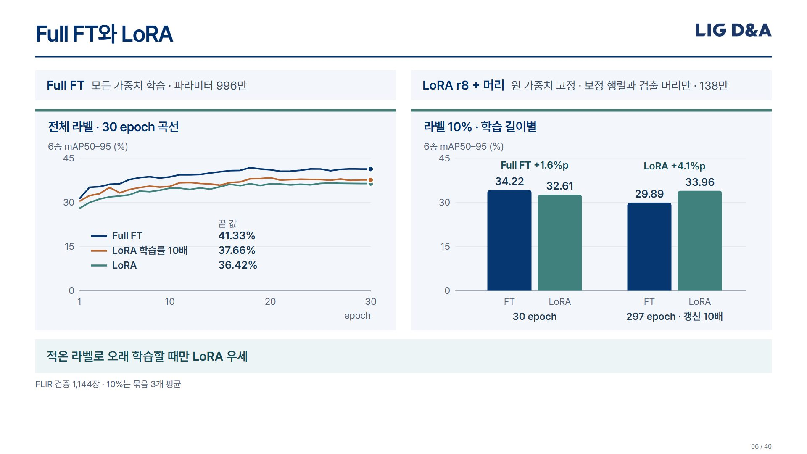
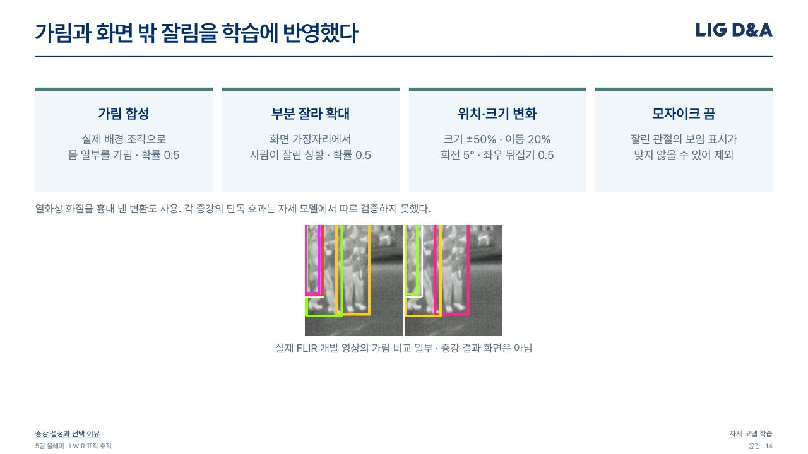
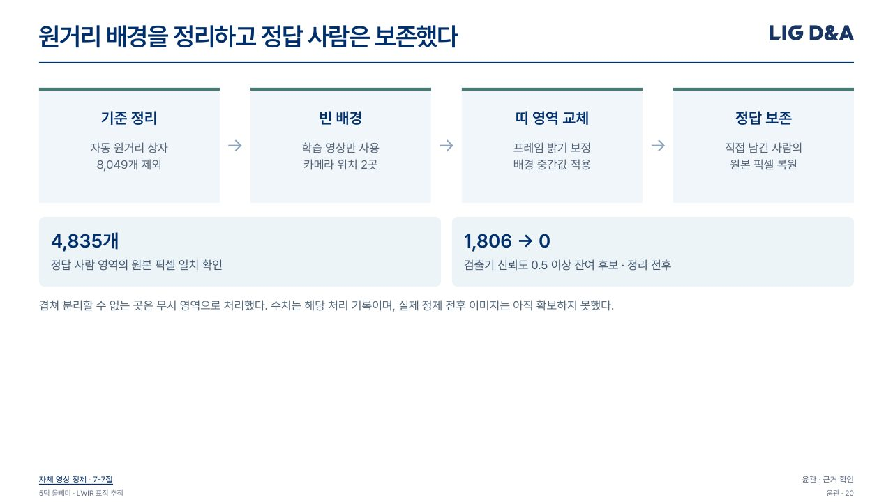
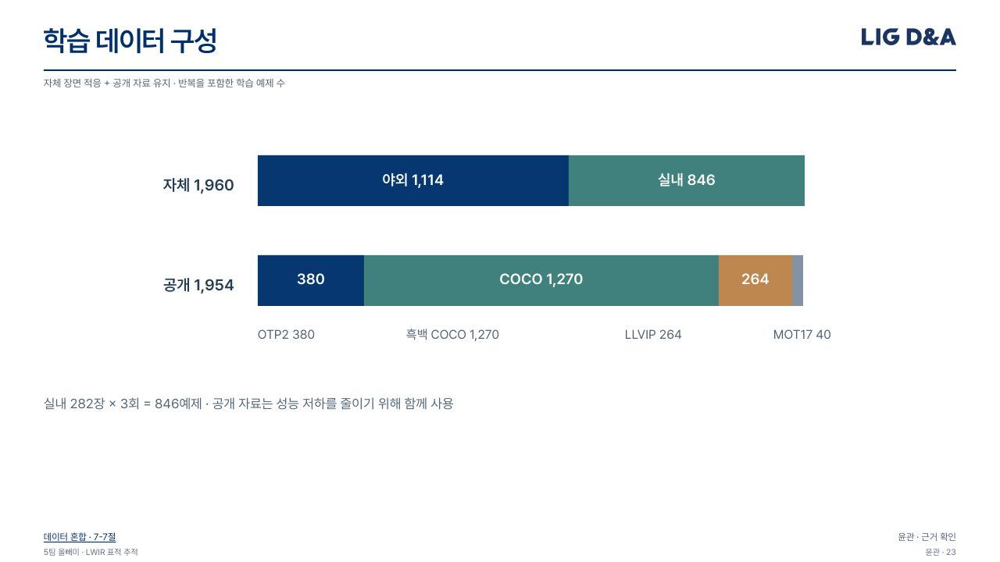
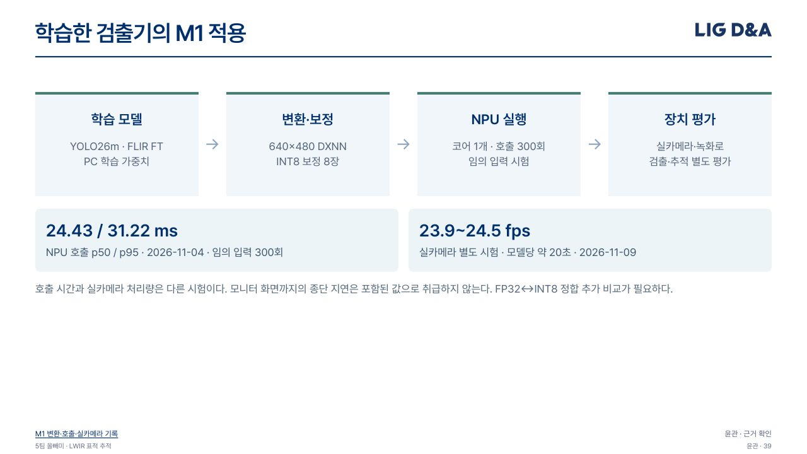
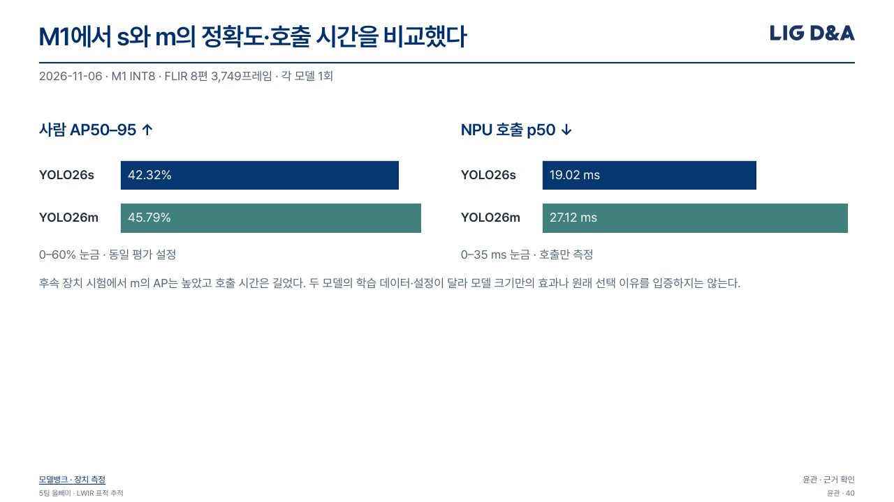
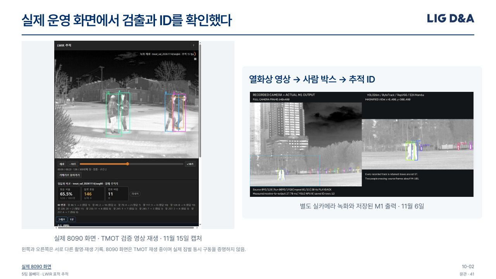
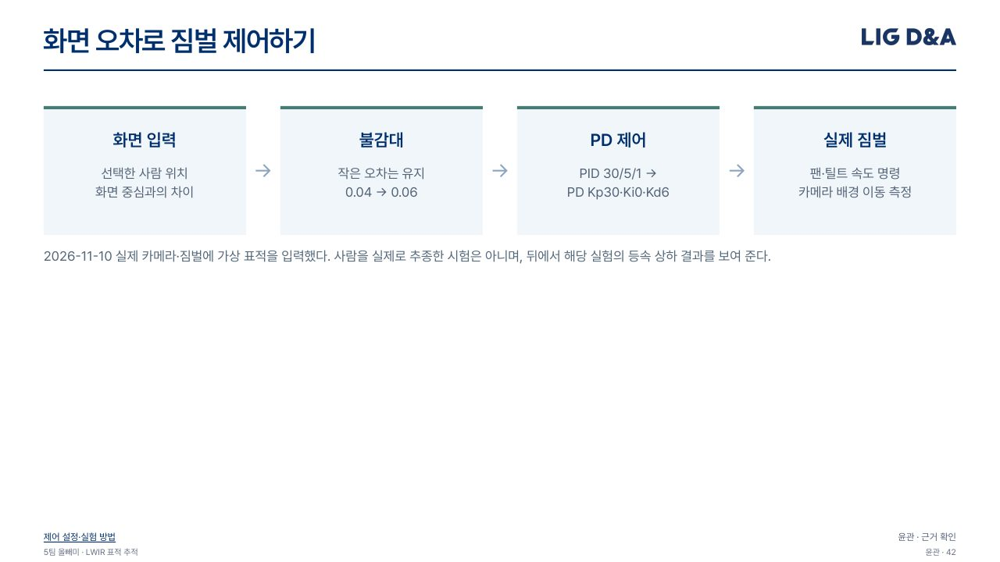

# 윤관 | 열화상 학습·추적과 짐벌 제어

[발표 흐름 PDF · 46장](발표_전체흐름.pdf) · [전체 근거 PDF · 72장](발표_전체근거.pdf) · [발표 대본](notes.md) · [출처](sources.md) · [HTML](index.html)

**흐름:** 모델 학습 → 자체 데이터·라벨 검수 → 추가 학습과 평가 → 추적 → M1 → 짐벌

*실제 라벨링 화면의 선택 부위는 검수 필요 상태이며, 해당 프레임의 학습 사용 여부는 확인되지 않았습니다.*

## 담당한 일과 전체 흐름

### 01. 제가 맡은 일

열화상 모델 학습·평가와 짐벌 제어를 맡았습니다.

### 02. 프로젝트는 이렇게 진행했습니다

데이터 준비부터 학습, 평가, 장치 시험까지 이어집니다.

## 1. 검출 모델 선택과 열화상 학습

### 03. YOLO26 계열 비교와 m급 학습

s급 모델 세 개를 비교한 뒤 YOLO26m을 학습했습니다.

### 04. FLIR 열화상으로 파인튜닝

COCO 가중치에서 시작해 FLIR 열화상에 맞췄습니다.

### 05. 30에폭으로 비교한 이유

30에폭은 최적값이 아니라 비교를 위한 최대 예산입니다.

### 06. 학습 곡선으로 본 FT와 LoRA

YOLO26s의 실제 에폭별 FT·LoRA 검증 곡선입니다.

### 07. 학습 데이터 규모에 따른 검증 정확도

채운 점은 실측값, 빈 점은 보간값입니다.

### 08. FT·LoRA: 학습량에 따라 달라진 결과

두 학습 예산에서 FT와 LoRA의 순위가 달랐습니다.

### 09. 같은 업데이트 횟수에서 FT·LoRA 비교

5,049 업데이트 조건의 라벨 묶음별 결과입니다.

### 10. 작은 검출기 증류는 종합 개선으로 이어지지 않았다

증류 후 오탐은 줄었지만 누락과 ID 변경은 늘었습니다.

### 11. 소형 객체 학습 후보 6개를 비교했다

소형 객체 후보 6개와 기존 모델을 비교했습니다.

## 2. 자세 모델과 자체 데이터

### 12. 자세 모델을 학습한 순서

공개 데이터에서 시작해 자체 카메라 후보로 이어졌습니다.

### 13. 데이터를 추가한 순서와 이유

데이터마다 보강하려는 장면이 달랐습니다.

### 14. 가림과 화면 밖 잘림을 학습에 반영했다

가림과 화면 밖 잘림을 학습에 반영했습니다.

### 15. 자세 모델의 학습 설정을 정했다

학습률과 배치, 에폭 설정을 정리했습니다.

### 16. 공개 데이터로 학습 결과를 검증했다

기존 E·F를 공개 데이터에서 평가했습니다.

### 17. 자체 카메라 데이터 확보

야외 15편과 실내 7편을 확보했습니다.

### 18. 자체 영상의 정답 기준

직접 남긴 사람을 정답으로 쓰는 기준을 정했습니다.

### 19. 실내·야외 실제 라벨링 화면

실제 실내·야외 편집 화면입니다. 선택 부위는 검수 필요 상태입니다.

### 20. 원거리 배경을 정리하고 정답 사람은 보존했다

원거리 배경을 정리하고 정답 사람의 픽셀을 보존했습니다.

### 21. 야외 관절 후보를 한 명씩 검수했다

야외 관절을 확인하고 불확실한 점은 미상으로 처리했습니다.

### 22. 실내 가림 장면은 박스와 관절을 다시 맞췄다

실내 가림 장면의 박스와 보이는 관절을 다시 표시했습니다.

### 23. 학습 데이터 구성

자체 자료와 공개 자료의 학습 예제 구성입니다.

### 24. 범용 F에서 추가 학습하기

범용 F에서 추가 학습하고 NF를 후보로 골랐습니다.

### 25. 첫 자체 학습 후보의 개선과 악화를 비교했다

먼 사람은 더 찾았지만 전체 검출과 오탐 기준은 통과하지 못했습니다.

### 26. 추적 점수는 올랐지만 모델은 바로 바꾸지 않았다

추적 점수는 올랐지만 다른 기준이 탈락해 교체하지 않았습니다.

### 27. 작은 사람의 상자 크기 오류를 찾아냈다

작은 사람과 큰 사람의 박스 기준이 달랐습니다.

### 28. 검수한 264장으로 V7 학습

검수한 264장으로 학습했지만 복수 사전 기준은 통과하지 못했습니다.

### 29. V8의 개선과 악화가 함께 나타났다

중복은 줄었지만 더 작은 사람의 누락과 자세 AP는 악화됐습니다.

## 3. 외형·위치 기억 모델

### 30. 이전 실험: OTP2 외형 모델 학습

OTP2로 학습한 이전 외형 모델의 PC 결과입니다.

### 31. 후속 실험: 검수 데이터로 외형 모델 학습

검수 데이터 추가 학습 후 두 평가셋의 결과가 달랐습니다.

### 32. SOLIDER 교사 적응의 추가 이득은 확인되지 않았다

교사 적응의 추가 이득은 확인되지 않았습니다.

### 33. 가려진 동안 위치를 기억하는 모델을 다시 학습했다

가려진 사람의 위치를 예측하도록 GRU를 다시 학습했습니다.

### 34. 장치 녹화에서 위치 기억의 추적 결과를 비교했다

같은 녹화 한 편의 장치 재생 결과입니다.

### 35. Mamba 위치 기억도 다시 학습해 비교했다

Mamba 오차는 줄었지만 같은 자료의 Kalman보다 높았습니다.

## 4. End-to-End FastTrackTr

### 36. FastTrackTr 논문 원형과 M1 구현을 구분했다

논문 원형과 M1 구현을 나란히 비교했습니다.

### 37. FastTrackTr 학습 조건을 설정했다

DanceTrack에서 시작해 열화상 자료로 이어 학습했습니다.

### 38. FastTrackTr 열화상 추가 학습 결과

TMOT 평균은 올랐고 실내 두 녹화는 낮아졌습니다.

## 5. M1 적용과 실제 운영 화면

### 39. 학습한 검출기의 M1 적용

검출기를 INT8으로 변환해 M1에서 시험했습니다.

### 40. M1에서 s와 m의 정확도·호출 시간을 비교했다

후속 장치 시험에서 s·m의 정확도와 호출 시간을 비교했습니다.

### 41. 실제 운영 화면에서 검출과 ID를 확인했다

실제 운영 화면과 별도 녹화의 M1 출력을 보여줍니다.

## 6. 짐벌 제어와 가림 전후 비교

### 42. 화면 오차로 짐벌 제어하기

화면 중심 오차를 팬·틸트 명령으로 연결했습니다.

### 43. 가림으로 사람을 놓쳤을 때 대응 기능을 추가했다

가림 중 위치 유지와 대상 보호 설정을 적용했습니다.

### 44. 불감대를 바꾸고 짐벌 응답을 측정했다

상하 반전은 줄었지만 별도 가로 시험의 뒤처짐은 늘었습니다.

### 45. 같은 FLIR 영상에서 가림 전과 재등장 뒤를 비교했다

같은 FLIR 영상의 가림 전과 재등장 뒤입니다.

## 7. 남은 과제

### 46. 결과와 남은 과제

확인한 결과와 더 필요한 자료를 구분했습니다.

---

정제 전후 사진과 짐벌 실물·실제 추종 영상은 더 필요합니다. 독립 평가와 반복 측정도 남아 있습니다. 상세 설명은 [발표 대본](notes.md), 실험 조건은 [출처](sources.md)를 확인해 주세요.

전체 근거 PDF는 발표 흐름 46장 뒤에 추가 자료를 담았습니다. 모델뱅크 `6cf676d`의 2026-11-17 기록까지 대조했습니다.
