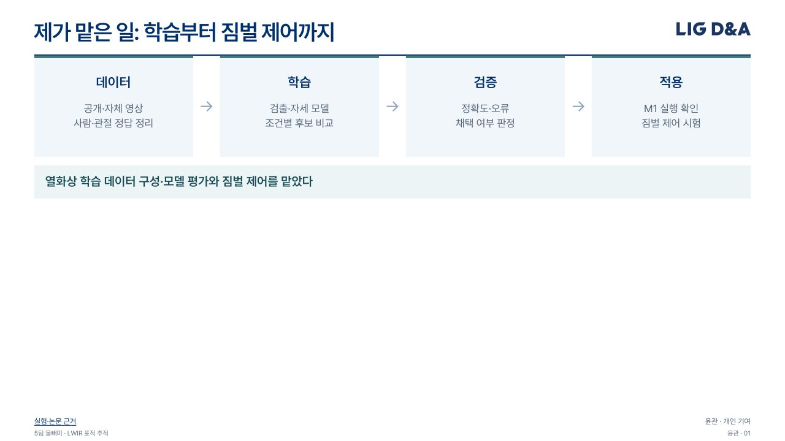
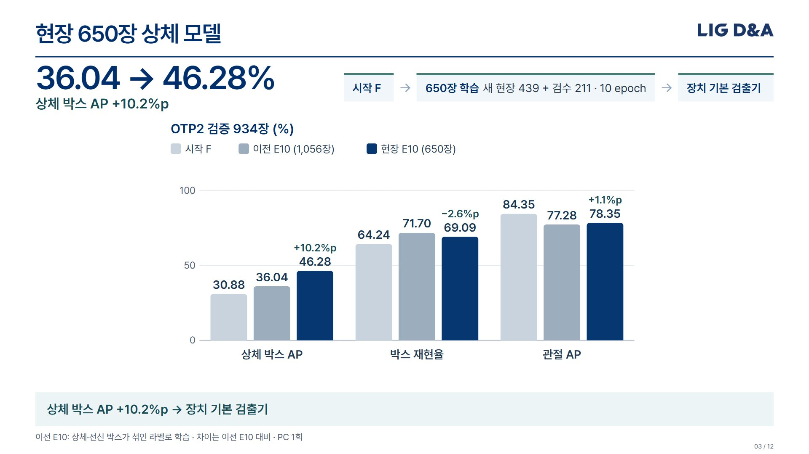
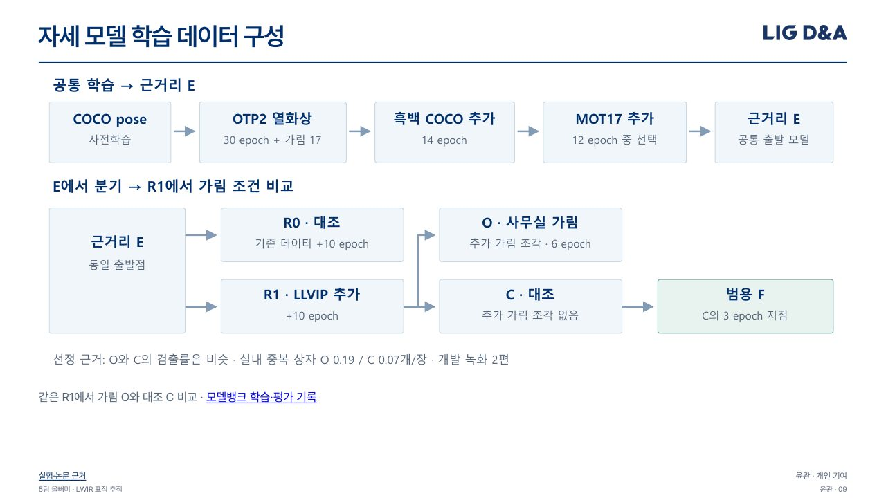
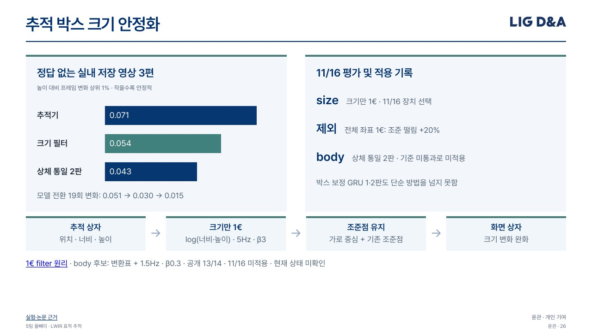
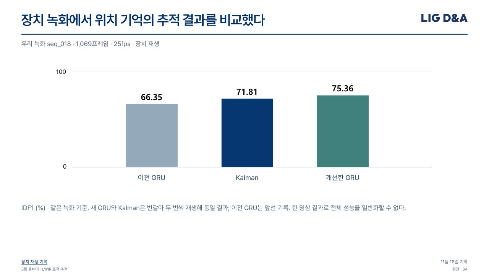
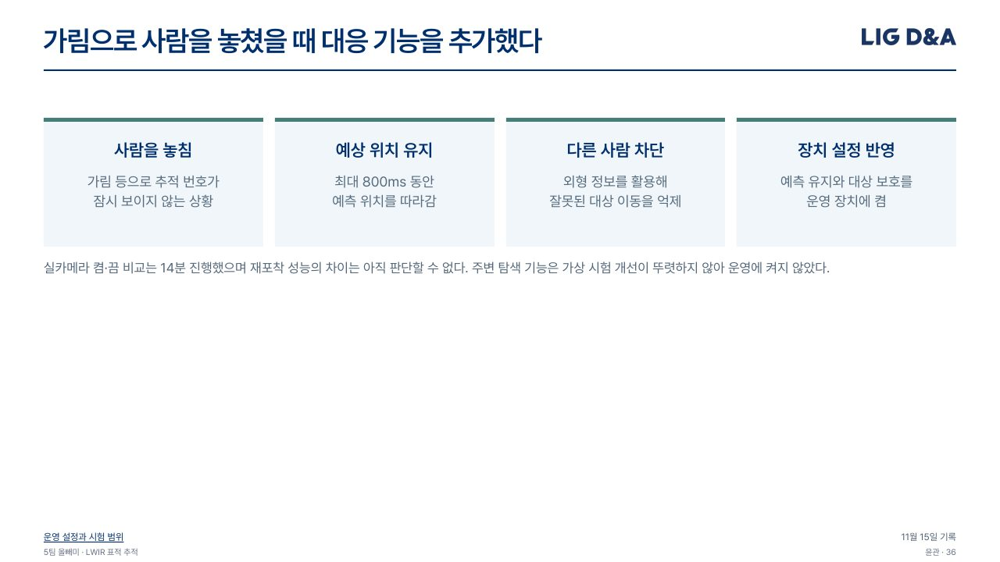
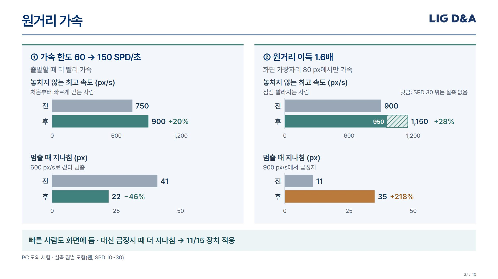

# 윤관 | 열화상 모델 학습 · 경량화 · 짐벌 추종

열화상 사람 검출·자세 모델 학습, 추적을 돕는 최신 모델 조사, M1에서 제때 돌리기 위한 경량화, 짐벌이 사람을 놓치지 않게 하는 튜닝과 실측을 정리했습니다.

**자료:** [발표 흐름 PDF](발표_전체흐름.pdf) · [근거 자료까지 PDF](발표_전체근거.pdf) · [발표 대본](notes.md) · [슬라이드별 근거](근거_슬라이드별.md) · [실험·논문 출처](sources.md) · [11월 20일 추가 근거](근거_최신_20261120.md) · [11월 19일 근거](근거_최신_20261119.md) · [평가자 검토](평가자_검토.md) · [모델별 입출력·로그](학습_입출력_로그.md) · [학습 설정·데이터 근거](학습_설정_데이터_근거.md) · [HTML로 보기](index.html)

**흐름:** 해결할 문제 → 열화상 검출기 학습 → 자세·상체 모델과 자체 데이터 → 추적 보완 모델(외형·위치 예측·FastTrackTr) → 경량화와 M1 실행 → 짐벌 추종 → 정리. 실험마다 조건이 다르며, 한 모델을 모든 단계로 이어서 학습한 이력은 아닙니다.

**고치는 법:** 장마다 `src/slides/`(화면), `src/notes/`(대본), `src/sources/`(근거) 파일이 있고 순서는 `src/deck.txt`입니다. `python src/build.py`로 HTML·대본·README를 만들고, `python src/render.py`로 PDF와 아래 그림을 만듭니다(Playwright 필요). 11월 19일 판은 git 기록(커밋 9819922)에 있습니다.

## 소개

### 01. 담당 범위

저는 열화상 모델 학습과 경량화, 최신 모델 조사를 맡았고, 짐벌 추종 개선도 함께 했습니다.

### 02. 해결할 문제

풀어야 할 문제는 작은 사람 검출, 가림 뒤 번호 유지, 한 장 33 ms 처리, 짐벌의 놓침 네 가지였습니다.

## 열화상 검출기 학습

### 03. 검출 모델 비교

같은 조건으로 학습한 s급 세 모델 중 YOLO26s가 사람 AP 44.93%로 가장 높아 YOLO26 계열로 정했습니다.

### 04. 열화상 전이학습

이전 m 모델의 학습 설정을 이어받고, 모자이크를 끈 마지막 10 epoch로 끝나도록 30 epoch로 고정했습니다.

### 05. 학습 곡선

YOLO26m은 27 epoch에서 사람 AP 50.75%로 가장 높았고 30 epoch도 50.62%로 거의 같아서 27 epoch 가중치를 골랐습니다.

### 06. Full FT와 LoRA

적은 라벨로 오래 학습한 경우에만 LoRA가 Full FT를 앞섰습니다.

### 07. 데이터 규모

학습 이미지가 많을수록 정확도가 올랐고, 네 규모 모두 Full FT가 LoRA보다 높았습니다.

### 08. 검출기 증류

큰 YOLO26m의 특징을 작은 YOLO26s에 전달하는 검출기 증류는 사람 검출과 추적을 함께 좋게 만들지 못해 채택하지 않았습니다.

## 자세·상체 모델

### 09. 학습 데이터

자세·상체 모델은 공개 데이터로 기본을 배우고, 자체 카메라 영상 650장으로 현장에 맞췄습니다.

### 10. 자세 모델 학습 과정

공개 데이터를 한 단계씩 더해 근거리 E를 만들고, 중·원거리 자료를 더해 범용 F를 만들었습니다.

### 11. 가림 증강

가림 증강은 몸이 가려지거나 화면 밖으로 잘려도 머리~골반 박스와 관절 위치를 정답으로 남겨 학습하는 방법입니다.

### 12. 공개 데이터 평가

범용 F는 공개 시험 세 지표 모두에서 근거리 E보다 높았고, 특히 작은 사람 검출이 크게 늘었습니다.

### 13. 자체 영상 라벨링

라벨 편집기로 사람 박스는 2만 장 넘게 검수했지만, 관절까지 검수한 장면은 140장뿐입니다.

### 14. 사람 박스 정의

학습에 쓰는 사람 박스는 보이는 부분이 아니라 머리 꼭대기부터 골반까지로 정했습니다.

### 15. 원거리 배경 정리

야외 녹화의 먼 줄에는 정답이 없는 사람이 많아서, 그 줄을 사람 없는 배경으로 바꿔 학습 자료를 정리했습니다.

### 16. 자체·공개 혼합 학습

자체 자료와 공개 자료를 같은 양으로 섞어 학습한 NF는 먼 사람을 훨씬 많이 찾았지만, 미리 정한 기준을 통과하지 못해 채택하지 않았습니다.

### 17. 검수 264장 학습

검수한 자체 영상 264장으로 학습한 V7과 V8은 상체 박스는 좋아졌지만, 관절과 작은 사람 검출이 시작 모델 F보다 나빠져 채택하지 않았습니다.

### 18. 현장 650장 상체 모델

새 현장 영상 439장과 기존 검수 211장, 모두 650장으로 학습한 상체 E10을 지금 장치의 기본 검출기로 쓰고 있습니다.

### 19. 교체 후보 재학습

E10을 바꿀 후보를 여러 방식으로 다시 학습했지만, 모든 기준에서 함께 앞선 후보가 없어 E10을 유지했습니다.

## 추적 보완 모델

### 20. 추적 보완 세 갈래

추적을 보완하려고 외형, 위치 예측, 종단간의 세 갈래를 시험했고, 외형과 위치 예측은 장치에서 쓰고 종단간은 보류했습니다.

### 21. 외형 모델

큰 교사 SOLIDER를 추적기에 직접 넣어도 번호 유지가 나아지지 않아, 장치는 작은 RepVGG를 그대로 씁니다.

### 22. 외형 모델 비교

교사 SOLIDER는 대형 트랜스포머라 M1에 올릴 수 없어서, 그 지식을 작은 RepVGG 학생에 옮겨 장치에서 씁니다.

### 23. 가림 위치 예측

가려져 검출이 끊긴 동안 최대 15프레임까지 Kalman 예측 경로를 GRU가 보정해 사람 위치를 이어 갑니다.

### 24. 위치 예측 결과

학습 입력 문제를 고친 뒤 GRU와 Mamba의 위치 오차는 약 3분의 1로 줄었지만, Kalman보다 낫지는 않았습니다.

### 25. 박스 크기 안정화

화면에 그리는 사람 상자가 덜 흔들리도록 크기 필터와 놓친 상자 크기 유지를 11월 16일부터 장치에서 켰습니다.

### 26. 상체 박스와 전신 표시

화면에는 같은 검출의 관절로 아래쪽을 넓힌 전신 박스를 고를 수 있게 했고, 추적과 짐벌 조준은 상체 박스를 그대로 씁니다.

### 27. FastTrackTr

검출과 번호 붙이기를 한 모델로 하는 FastTrackTr을 M1에서 돌게 만들고 열화상으로 더 학습했지만, 기존 검출과 추적기의 절반에도 못 미쳐 11월 15일에 학습을 멈췄습니다.

## 경량화·M1 실행

### 28. INT8 변환

DX-COM 컴파일 옵션 하나로 M1의 한 장 처리 시간을 25% 줄였고 정확도는 그대로였습니다.

### 29. M1 모델 속도

YOLO26m은 s보다 사람 AP가 3.47%p 높지만 M1에서 한 번 호출하는 데 43% 더 걸립니다.

### 30. 두 NPU 한 장 분할

한 장을 둘로 나눠 NPU 0과 1에서 동시에 검출하니, 사람이 없는 실카메라에서 한 장 처리 p95가 23 ms로 내려왔습니다.

### 31. 33 ms 꼬리 줄이기

느린 한 장을 만든 원인을 하나씩 찾아 고쳐 최대 지연을 줄였지만, 모든 장 33 ms 목표는 아직 못 맞췄습니다.

## 짐벌 추종

### 32. 짐벌 추종 구조

짐벌은 고른 사람의 상체 박스 중심이 화면 가운데에 오도록, 추적 결과가 올 때마다 팬·틸트 속도를 다시 계산합니다.

### 33. PD 제어와 불감대

불감대를 0.06으로 넓혀 세로로 왔다 갔다 하는 반전을 4회에서 1회로 줄였고, 대신 가로로 따라갈 때 뒤처짐이 14.3에서 18.6픽셀로 30% 늘었습니다.

### 34. 짐벌 실측 응답

실제 짐벌은 SPD 10에서 30 사이에서 SPD 1당 화면에서 약 31 px/s씩 빨라졌고, 명령 뒤 0.108초에 움직이기 시작해 STOP 뒤 0.064초에 멈췄습니다.

### 35. 가상 카메라 시험

가상 카메라 시험은 실제 짐벌을 돌리지 않고도 장치 전체를 같은 장면으로 반복 비교하고 정답으로 채점하는 방법입니다.

### 36. 원거리 가속

실측한 짐벌 속도로 모의 시험을 다시 해서, 빠른 사람을 화면에 더 오래 두도록 속도 설정 두 가지를 바꿨습니다.

### 37. 짐벌까지 지연

장면이 바뀐 뒤 짐벌이 움직이기까지 약 0.2초가 걸리고, 그중 줄일 수 있는 대기와 멈춤을 없앴습니다.

### 38. 놓쳤을 때 대응

사람을 놓쳤을 때 쓰는 기능 가운데 가상 시험에서 효과가 확인된 것은 놓친 자리의 예측을 따라가는 기능 하나입니다.

## 정리

### 39. 정리

학습한 모델과 짐벌 개선은 장치에 올렸고, 남은 일은 실제 조건에서 재는 것입니다.
