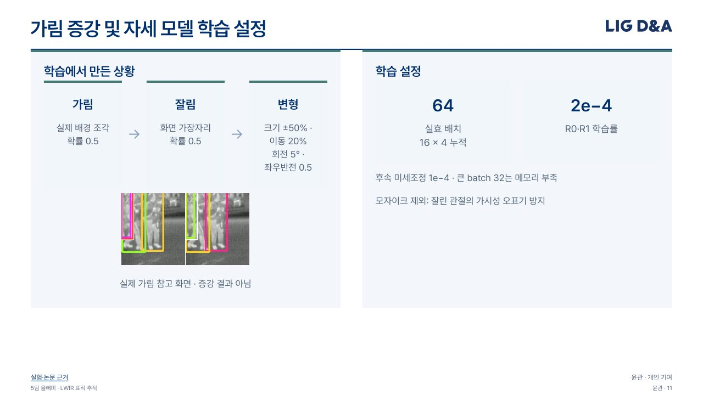
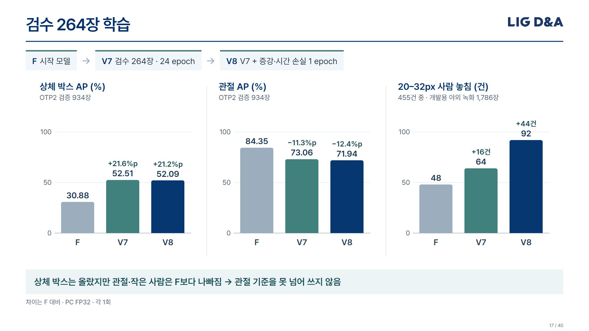
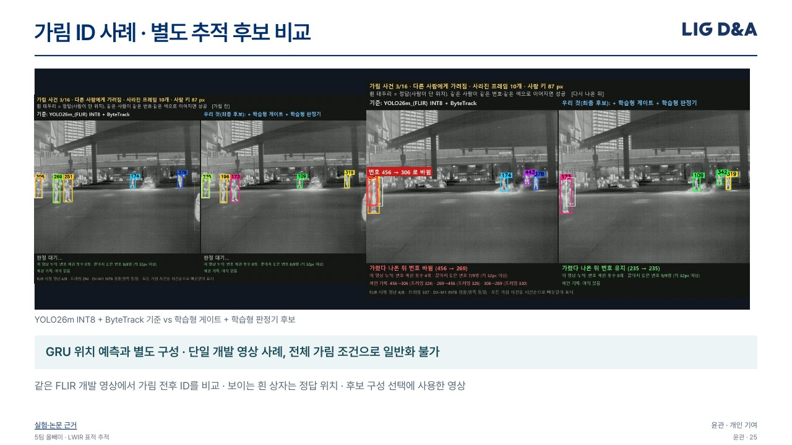
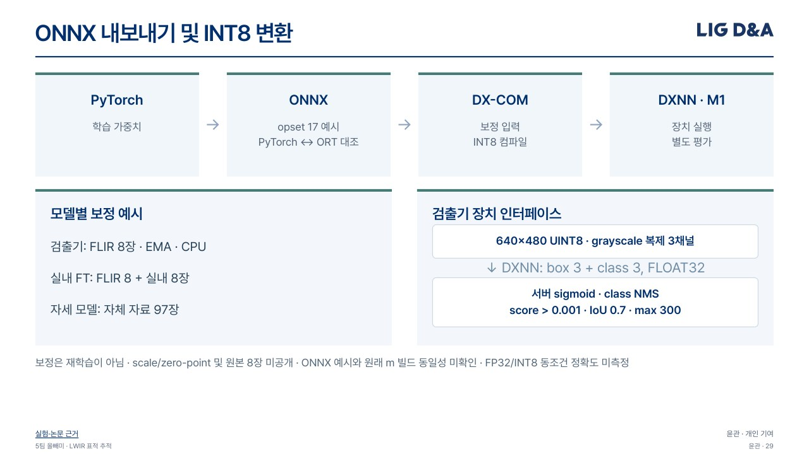
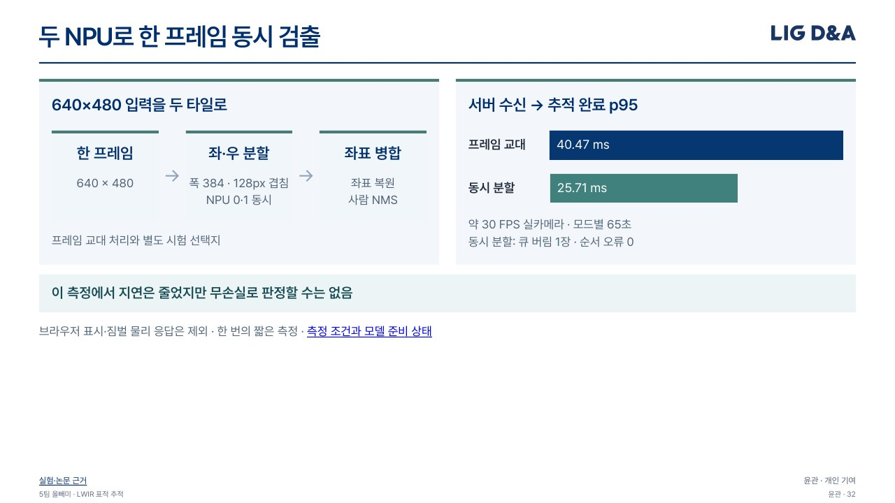

# 윤관 | 열화상 모델 학습과 짐벌 제어

제가 맡은 학습과 짐벌 제어를 과정별로 정리했습니다. 관련된 선택 이유와 결과는 같은 장에서 볼 수 있습니다.

[발표 흐름 PDF · 35장](발표_전체흐름.pdf) · [상세 근거 PDF · 103장](발표_전체근거.pdf) · [발표 대본](notes.md) · [이전 상세 대본 · 별도 72장](notes_상세.md) · [논문·실험 출처](sources.md) · [평가자 검토](평가자_검토.md) · [모델별 입출력·로그](학습_입출력_로그.md) · [학습 설정·데이터 근거](학습_설정_데이터_근거.md) · [11월 19일 최신 근거](근거_최신_20261119.md) · [HTML로 보기](index.html)

**발표 흐름:** 열화상 검출 학습·실험 비교 → 자세 학습의 데이터 계보 → 실제 라벨링과 후속 박스 생성·자체 학습 → 외형(ReID)·위치 예측(GRU/Mamba)·FastTrackTr의 세 갈래 → 추적 결과·박스 안정화 → ONNX/DXNN·M1 → 짐벌 제어. 각 실험은 별도 조건이며 한 모델을 모두 순차 학습한 이력은 아닙니다.

*발표 대본은 35장 흐름과 일치합니다. 이전 상세 대본은 별도 72장 초안입니다.*

*논문은 원리 참고자료입니다. 실제 라벨링 사진은 작업 중 화면이며, 선택 부위는 검수 필요 상태입니다.*

## 데이터와 탐지·자세 모델 학습

### 01. 담당 역할 및 개발 범위

저는 학습을 중심으로 데이터 라벨을 정리하고 검출·자세 모델을 학습한 뒤 후보를 평가했습니다.

### 02. 열화상 탐지 모델 검증 비교

FLIR 검증에서 YOLOX 39.96%, YOLOv8 42.28%, YOLO26s 44.93%를 비교했습니다.

### 03. FLIR 데이터 기반 전이학습

COCO 가시광에서 FLIR 열화상으로 옮기면 영상의 밝기와 질감이 다르므로, 사전학습 가중치를 열화상으로 파인튜닝했습니다.

### 04. 30 epoch 설정과 검증 결과

FT·LoRA 비교의 공통 예산과 별도 YOLO26m의 실제 학습 시간·체크포인트별 검증 결과를 함께 확인했습니다. [기록과 원자료](근거_30epoch.md)

### 05. Full FT·LoRA 학습 로그 및 검증 성능

Full fine-tuning은 사전학습 가중치를 함께 갱신하고, LoRA는 기존 가중치를 고정한 뒤 작은 저랭크 행렬을 학습합니다.

### 06. 데이터 규모에 따른 검증 성능

YOLO26s, FLIR 6개 클래스, 30 epoch, seed202에서 네 데이터 규모를 측정했고 빈 점은 그 사이를 직선 보간했습니다.

### 07. 학습 예산별 FT·LoRA 성능 비교

두 조건 모두 라벨 10%, FLIR 검증 1,144장입니다.

### 08. YOLO 검출기 증류 실험

이것은 검출기 YOLO26m에서 YOLO26s로 간 증류 실험입니다.

### 09. 공개 데이터와 실제 촬영 데이터의 차이

열화상과 흑백 가시광, 직접 촬영한 영상의 장면·라벨·사용 목적을 비교했습니다.

### 10. 자세 모델 학습 데이터 구성

COCO pose에서 시작해 OTP2 열화상, 가림 증강, 흑백 COCO, MOT17 순으로 학습해 근거리 E를 만들었습니다.

### 11. 공개 데이터로 자세 모델을 이어 학습한 과정

COCO → OTP2 → 가림 증강 → 흑백 COCO → MOT17 → LLVIP-Pose의 학습 역할과 라벨 생성 방식을 정리했습니다.

### 12. 가림 증강 및 자세 모델 학습 설정

가림은 실제 장면 배경 조각으로 확률 0.5, 프레임 밖 잘림도 확률 0.5로 적용했습니다.

### 13. 탐지·자세 모델 학습 입출력 및 평가

탐지 학습에는 열화상 이미지와 클래스·상자 정답을 넣고, 모델이 상자 위치와 클래스 점수를 예측하도록 학습합니다.

### 14. 공개 데이터셋 기반 자세 모델 평가

OTP2 test에서 관절 AP는 E 80.4, F 85.1이었습니다.

### 15. 자체 열화상 영상 라벨링

자체 카메라 녹화는 야외 15편 8,929장, 실내 7편입니다.

### 16. 사람 박스 정의 및 학습 라벨 생성

열화상 라벨 편집기에서는 사람 한 명에 박스와 ID 하나를 두고, 머리와 몸통·관절은 그 사람에 연결해 검수했습니다.

### 17. 원거리 배경 정제 및 관절 검수

원거리 자동 상자 8,049개를 제외하고 카메라 위치 두 곳의 빈 배경 띠를 정리해 프레임 밝기를 맞췄습니다.

### 18. 자체·공개 데이터 혼합 학습

학습 예제는 자체 야외 1,114, 실내 846, 공개 OTP2 380, 회색조 COCO 1,270, LLVIP 264, MOT17 40이었습니다.

### 19. 별도 실험 · 검수 264장으로 V7·V8 평가

V7은 사람 검수 영상 264장, 5장 정정과 증강을 사용해 YOLO26m-pose를 24 epoch, 213 updates 학습했습니다.

## 외형 모델·추적·M1·짐벌

### 20. 현장 650장으로 상체 모델 학습

현장 라벨 650장으로 학습한 E10과 추가 시간 손실 실험을 검증했습니다.

### 21. 추적 성능을 보완한 세 가지 별도 갈래

외형 모델에서는 사람 이미지로 사전학습한 SOLIDER의 특징을 RepVGG 학생으로 옮기는 증류를 시험했습니다.

### 22. 외형 모델 추가 학습 및 평가

OTP2 시험 신원 60명에서 이전 RepVGG 몸 상자 Rank-1은 72%에서 89%로, 잘림은 18%에서 27%로, 가림은 65%에서 84%로 바뀌었습니다.

### 23. 가림 상황의 위치 예측: GRU·Mamba

사람이 보일 때 최근 최대 20프레임의 상자, 속도와 관절 특징을 기록합니다.

### 24. GRU·Kalman 위치 예측 및 ID 비교

자체 TEST 14편, 유실 238건에서 Kalman 위치 오차는 0.110, 이전 GRU 0.336, 수정 GRU 0.122였습니다.

### 25. 가림 ID 사례 · 별도 추적 후보 비교

왼쪽은 동일한 가림 사건의 열화상 입력, 오른쪽은 기준 tracker와 후보를 나란히 시각화한 비교입니다.

### 26. 추적 박스 크기 안정화

짐벌이 보는 상자가 흔들려 조준점이 튀는 문제를 줄이기 위해 박스 크기 필터와 상체 기준 통일을 시험했습니다.

### 27. 상체 박스와 전신 표시

같은 검출의 상체와 전신 추정 표시를 실제 장치 재생 화면으로 비교했습니다.

### 28. 별도 종단간 실험 · FastTrackTr

FastTrackTr은 학습 때 DanceTrack 36편의 grayscale 640×480 영상을 사용했고 RT-DETR ResNet18 COCO 가중치에서 시작했습니다.

### 29. ONNX 내보내기 및 INT8 변환

학습 PyTorch 가중치를 ONNX로 내보내고 보정 입력으로 DX-COM 컴파일을 거쳐 DXNN을 만듭니다.

### 30. 외형·FastTrackTr 모델 변환

외형 모델의 공개 OTP2 변환 예시는 RepVGG 추론 구조를 합쳐 ONNX opset 17로 내보내고 256 crop으로 EMA 보정합니다.

### 31. M1 병렬 처리 및 모델 성능

11월 3일 저장 FLIR 영상에서 검출을 NPU 0과 1에 교대로 투입하고 CPU 광류, NPU 2의 외형 추출을 겹쳤습니다.

### 32. 두 NPU로 한 프레임 동시 검출

두 NPU의 동시 분할 구조와 65초 구간에서 측정한 지연·큐 버림을 정리했습니다.

### 33. M1 운영 화면

실제 TMOT 저장 영상을 재생하는 운영 화면을 넣었습니다.

### 34. 짐벌 제어 및 실제 장치 응답

검출·추적에서 선택한 사람 중심과 화면 중심의 차이를 제어 입력으로 써 팬·틸트 명령을 만들었습니다.

### 35. 주요 성과 및 후속 검증

내 담당은 열화상 검출과 자세 학습, 외형·위치 기억 비교, 모델을 장치에 올리는 과정, 짐벌 제어입니다.
