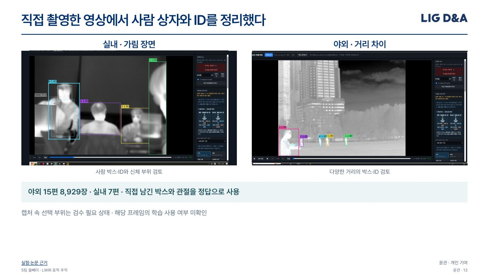
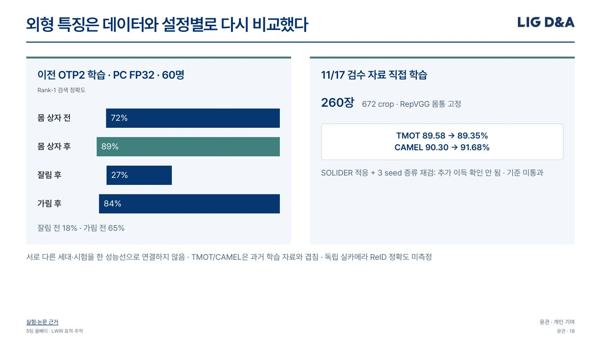
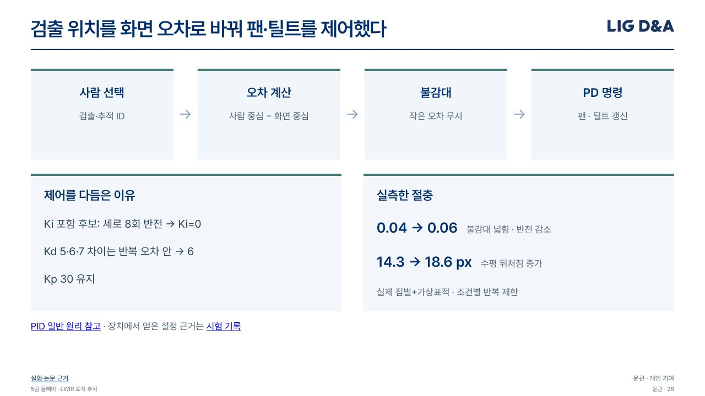

# 윤관 | 열화상 모델 학습과 짐벌 제어

제가 맡은 학습과 짐벌 제어를 과정별로 정리했습니다. 관련된 선택 이유와 결과는 같은 장에서 볼 수 있습니다.

[발표 흐름 PDF · 30장](발표_전체흐름.pdf) · [상세 근거 PDF · 97장](발표_전체근거.pdf) · [발표 대본](notes.md) · [상세 대본](notes_상세.md) · [논문·실험 출처](sources.md) · [모델별 입출력·로그](학습_입출력_로그.md) · [HTML로 보기](index.html)

**흐름:** 탐지 학습 → 자체 데이터·라벨 → 자세·외형 학습 → 위치 예측·박스 안정화 → FastTrackTr → M1 → 짐벌

*논문은 원리 참고자료입니다. 실제 라벨링 사진은 작업 중 화면이며, 선택 부위는 검수 필요 상태입니다.*

## 데이터와 탐지·자세 모델 학습

### 01. 제가 맡은 일: 학습부터 짐벌 제어까지

저는 학습을 중심으로 데이터 라벨을 정리하고 검출·자세 모델을 학습한 뒤 후보를 평가했습니다.

### 02. 검증 결과를 보고 YOLO 계열을 좁혔다

FLIR 검증에서 YOLOX 39.96%, YOLOv8 42.28%, YOLO26s 44.93%를 비교했습니다.

### 03. 가시광 사전학습을 FLIR 열화상에 맞췄다

COCO 가시광에서 FLIR 열화상으로 옮기면 영상의 밝기와 질감이 다르므로, 사전학습 가중치를 열화상으로 파인튜닝했습니다.

### 04. 30에폭 비교와 소형 후보 실험을 분리해 봤다

30 epoch는 비교에 쓴 최대 예산이지 최적 종료가 입증된 epoch가 아닙니다.

### 05. FT와 LoRA: 방식과 실제 학습 로그

Full fine-tuning은 사전학습 가중치를 함께 갱신하고, LoRA는 기존 가중치를 고정한 뒤 작은 저랭크 행렬을 학습합니다.

### 06. 데이터가 늘수록 검증값이 올랐지만 업데이트도 늘었다

YOLO26s, FLIR 6개 클래스, 30 epoch, seed202에서 네 데이터 규모를 측정했고 빈 점은 그 사이를 직선 보간했습니다.

### 07. 같은 라벨 비율에서 학습 예산에 따라 순위가 바뀌었다

두 조건 모두 라벨 10%, FLIR 검증 1,144장입니다.

### 08. 작은 검출기 증류는 계산량을 줄이려 했지만 종합 성능은 오르지 않았다

이것은 검출기 YOLO26m에서 YOLO26s로 간 증류 실험입니다.

### 09. 자세 모델은 열화상과 가림 자료를 단계적으로 더했다

자세 모델은 COCO pose 사전학습에서 출발했습니다.

### 10. 탐지와 자세 모델: 무엇을 넣고 무엇을 확인했나

탐지 학습에는 열화상 이미지와 클래스·상자 정답을 넣고, 모델이 상자 위치와 클래스 점수를 예측하도록 학습합니다.

### 11. 가림 증강과 학습 예산을 함께 조정했다

가림은 실제 장면 배경 조각으로 확률 0.5, 프레임 밖 잘림도 확률 0.5로 적용했습니다.

### 12. 공개 데이터에서 근거리와 원거리의 차이를 확인했다

OTP2 test에서 관절 AP는 E 80.4, F 85.1이었습니다.

### 13. 직접 촬영한 영상에서 사람 상자와 ID를 정리했다

자체 카메라 녹화는 야외 15편 8,929장, 실내 7편입니다.

### 14. 먼 사람과 가려진 관절은 실제 화면을 보며 정제했다

원거리 자동 상자 8,049개를 제외하고 카메라 위치 두 곳의 빈 배경 띠를 정리해 프레임 밝기를 맞췄습니다.

### 15. 공개 자료와 자체 영상을 섞어 첫 후보를 비교했다

학습 예제는 자체 야외 1,114, 실내 846, 공개 OTP2 380, 회색조 COCO 1,270, LLVIP 264, MOT17 40이었습니다.

### 16. 검수 데이터 후보도 한쪽 지표가 좋아지면 다른 지표가 나빠졌다

V7은 사람 검수 영상 264장, 5장 정정과 증강을 사용해 YOLO26m-pose를 24 epoch, 213 updates 학습했습니다.

## 외형 모델·추적·M1·짐벌

### 17. 외형 모델: 교사 표현을 M1 학생으로 옮겨 검증

외형 모델에서는 사람 이미지로 사전학습한 SOLIDER의 특징을 RepVGG 학생으로 옮기는 증류를 시험했습니다.

### 18. 외형 특징은 데이터와 설정별로 다시 비교했다

OTP2 시험 신원 60명에서 이전 RepVGG 몸 상자 Rank-1은 72%에서 89%로, 잘림은 18%에서 27%로, 가림은 65%에서 84%로 바뀌었습니다.

### 19. 가려진 동안의 위치를 기억하는 GRU

사람이 보일 때 최근 최대 20프레임의 상자, 속도와 관절 특징을 기록합니다.

### 20. 사람을 다시 찾는 모델: 외형 특징과 위치 기억

외형 모델은 사람 crop과 신원 라벨을 학습 입력으로 사용해 128차원 embedding을 출력합니다.

### 21. GRU의 장점과 한계를 두 지표로 확인했다

자체 TEST 14편, 유실 238건에서 Kalman 위치 오차는 0.110, 이전 GRU 0.336, 수정 GRU 0.122였습니다.

### 22. 짐벌 조준을 위해 박스 크기만 다듬었다

짐벌이 보는 상자가 흔들려 조준점이 튀는 문제를 줄이기 위해 박스 크기 필터와 상체 기준 통일을 시험했습니다.

### 23. FastTrackTr: 왜 학습하고 무엇을 출력했나

FastTrackTr은 학습 때 DanceTrack 36편의 grayscale 640×480 영상을 사용했고 RT-DETR ResNet18 COCO 가중치에서 시작했습니다.

### 24. 학습 모델을 DXNN으로 바꾸고 INT8로 보정

학습 PyTorch 가중치를 ONNX로 내보내고 보정 입력으로 DX-COM 컴파일을 거쳐 DXNN을 만듭니다.

### 25. ReID와 FastTrackTr은 변환 구조가 다르다

외형 모델의 공개 OTP2 변환 예시는 RepVGG 추론 구조를 합쳐 ONNX opset 17로 내보내고 256 crop으로 EMA 보정합니다.

### 26. M1에서 병렬 처리와 작은 모델 실행 시간을 비교했다

11월 3일 저장 FLIR 영상에서 검출을 NPU 0과 1에 교대로 투입하고 CPU 광류, NPU 2의 외형 추출을 겹쳤습니다.

### 27. 실제 운영 화면에서 검출·ID 연결을 확인했다

실제 TMOT 저장 영상을 재생하는 운영 화면을 넣었습니다.

### 28. 검출 위치를 화면 오차로 바꿔 팬·틸트를 제어했다

검출·추적에서 선택한 사람 중심과 화면 중심의 차이를 제어 입력으로 써 팬·틸트 명령을 만들었습니다.

### 29. 가림 전후 ID가 유지되는 사례를 비교했다

왼쪽은 동일한 가림 사건의 열화상 입력, 오른쪽은 기준 tracker와 후보를 나란히 시각화한 비교입니다.

### 30. 제가 맡은 흐름과 남은 검증

내 담당은 열화상 검출과 자세 학습, 외형·위치 기억 비교, 모델을 장치에 올리는 과정, 짐벌 제어입니다.
