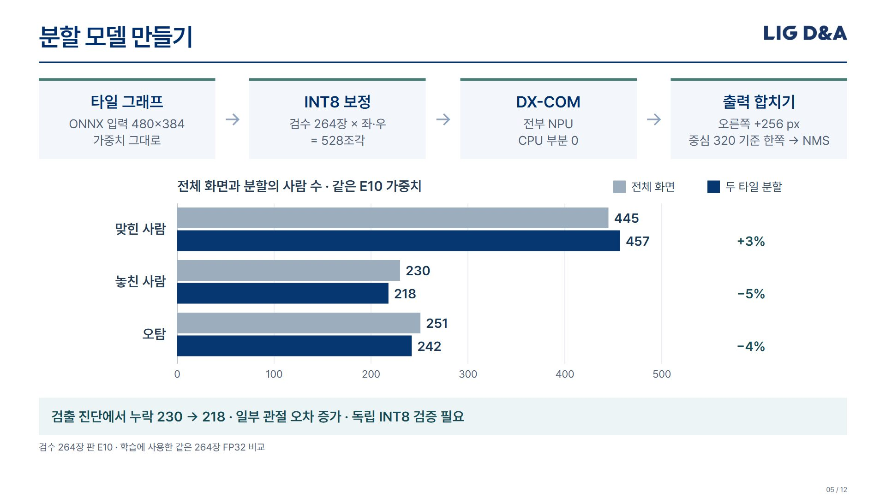
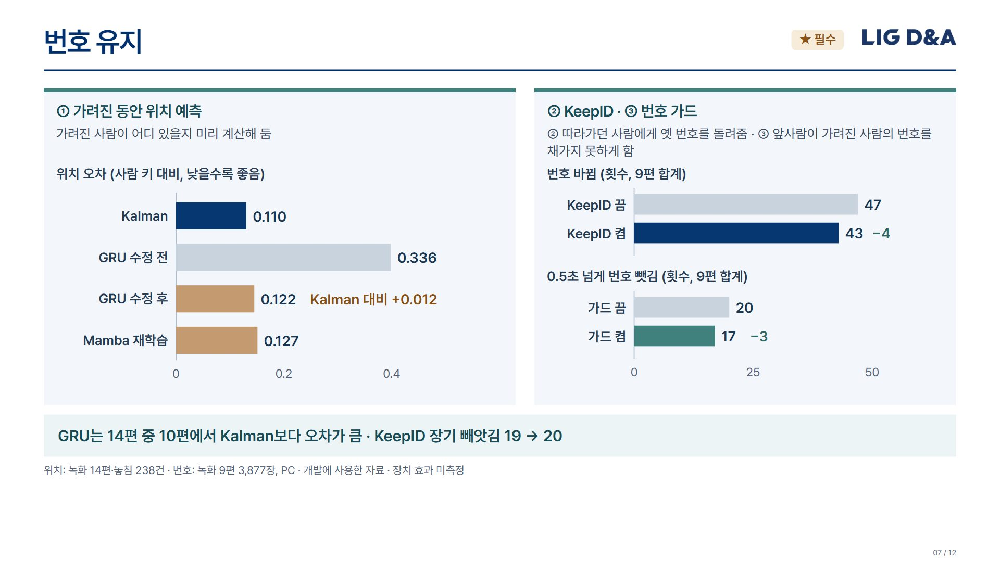

# 윤관 | 열화상 모델 학습 · 경량화 · 짐벌 추종

열화상 사람 검출·자세 모델 학습, 추적을 돕는 최신 모델 조사, M1에서 제때 돌리기 위한 경량화, 짐벌이 사람을 놓치지 않게 하는 튜닝과 실측을 정리했습니다.

**자료:** [발표 흐름 PDF](발표_전체흐름.pdf) · [근거 자료까지 PDF](발표_전체근거.pdf) · [발표 대본](notes.md) · [슬라이드별 근거](근거_슬라이드별.md) · [실험·논문 출처](sources.md) · [11월 20일 추가 근거](근거_최신_20261120.md) · [11월 19일 근거](근거_최신_20261119.md) · [평가자 검토](평가자_검토.md) · [모델별 입출력·로그](학습_입출력_로그.md) · [학습 설정·데이터 근거](학습_설정_데이터_근거.md) · [학습 기록: 외형 모델](학습기록_외형모델.md) · [학습 기록: 상체 검출기](학습기록_상체검출기.md) · [학습 기록: 위치 예측](학습기록_위치예측.md) · [학습 기록: FastTrackTr](학습기록_FastTrackTr.md) · [HTML로 보기](index.html)

**발표 흐름 12장(약 8분):** 주요 실험 결과 → 맡은 일 전체 → 현장 650장 상체 모델 → INT8 변환 → 분할 모델 만들기 → 외형 모델 비교 → 번호 유지(★) → 장비 안정화 → 가상 카메라 시험(★) → 짐벌 실측과 놓침 대응 → 채택과 보류 기준(★) → 정리. ★는 필수 장입니다. **근거 자료:** 기존 38장 흐름(해결할 문제 → 검출기 학습 → 자세·상체 모델 → 추적 보완 모델 → 경량화와 M1 → 짐벌 → 정리)의 나머지 34장과 부록이 `all-slides.html`과 근거 PDF에 있습니다. 실험마다 조건이 다르며, 한 모델을 모든 단계로 이어서 학습한 이력은 아닙니다.

**고치는 법:** 장마다 `src/slides/`(화면), `src/notes/`(대본), `src/sources/`(근거) 파일이 있고 순서는 `src/deck.txt`입니다. `python src/build.py`로 HTML·대본·README를 만들고, `python src/render.py`로 PDF와 아래 그림을 만듭니다(Playwright 필요). 11월 19일 판은 git 기록(커밋 9819922)에 있습니다.

## 소개

### 01. 주요 실험 결과

안녕하세요, 윤관입니다.

### 02. 맡은 일 전체

제가 맡은 일을 한 장으로 보여 드리겠습니다.

## 자세·상체 모델

### 03. 현장 650장 상체 모델

현장 439장과 기존 검수 211장, 합계 650장으로 10 epoch 학습했습니다.

## 경량화·M1 실행

### 04. INT8 변환

YOLO26s의 컴파일 옵션만 바꿔 FLIR 시험 3,749장을 비교했습니다.

### 05. 분할 모델 만들기

E10 가중치를 유지한 채 타일 입력으로 다시 변환했습니다.

## 추적 보완 모델

### 06. 외형 모델 비교

외형 모델 네 종류를 M1 INT8에서 비교했습니다.

### 07. 번호 유지

자체 열화상 녹화 14편의 놓침 238건에서 Kalman 위치 오차는 0.110, 수정 GRU는 0.122였습니다.

## 짐벌 추종

### 08. 장비 안정화

카메라 읽는 박자를 고정 격자로 맞춘 뒤 해당 장치 구간에서 주기적 화면 반복은 분당 8.4회에서 0회가 됐습니다.

### 09. 가상 카메라 시험

열화상 녹화에서 잘라낸 창을 가상 카메라로 쓰고, 실제 검출·추적·제어 코드를 연결해 같은 장면을 반복했습니다.

### 10. 짐벌 실측과 놓침 대응

실제 짐벌은 SPD 10, 20, 30에서 각각 약 305, 630, 930 px/s로 움직였고, 명령 후 화면 반응까지 0.108초였습니다.

## 정리

### 11. 채택과 보류 기준

시험 결과를 기준으로 장치 적용과 보류를 결정했습니다.

### 12. 정리

상체 박스 AP가 오른 시험에서도 재현율은 낮아졌고, 지연이 줄어든 입력 축소 후보도 최대 지연 기준을 넘겼습니다.
