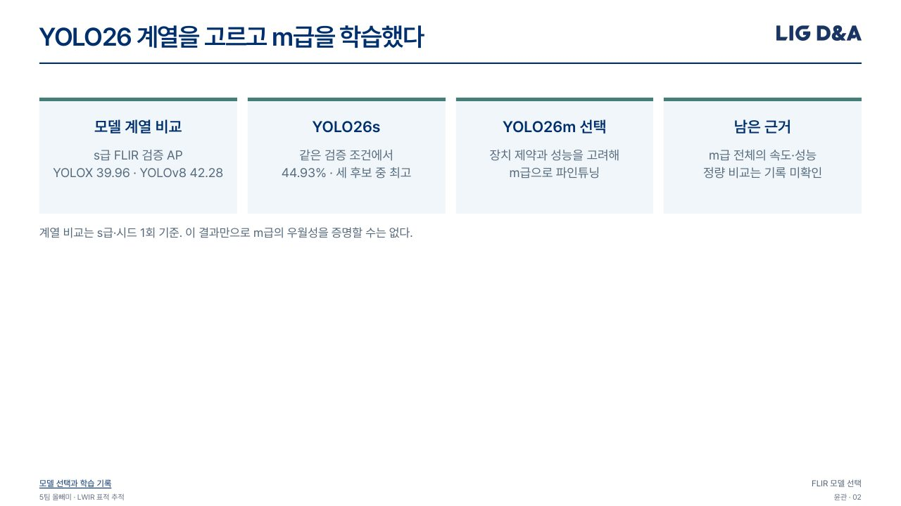
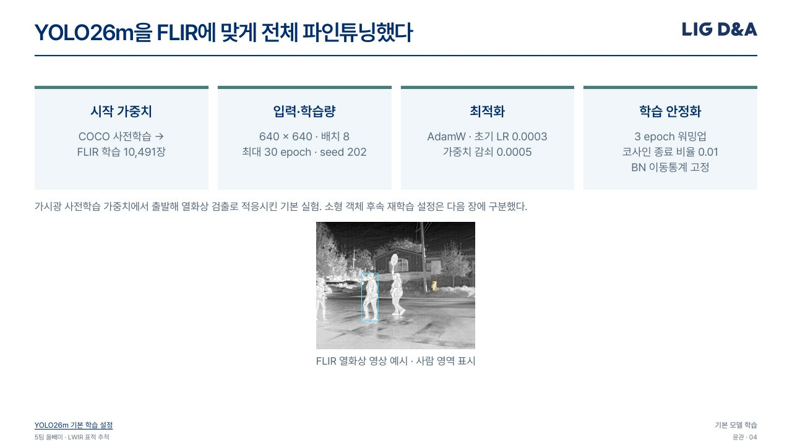
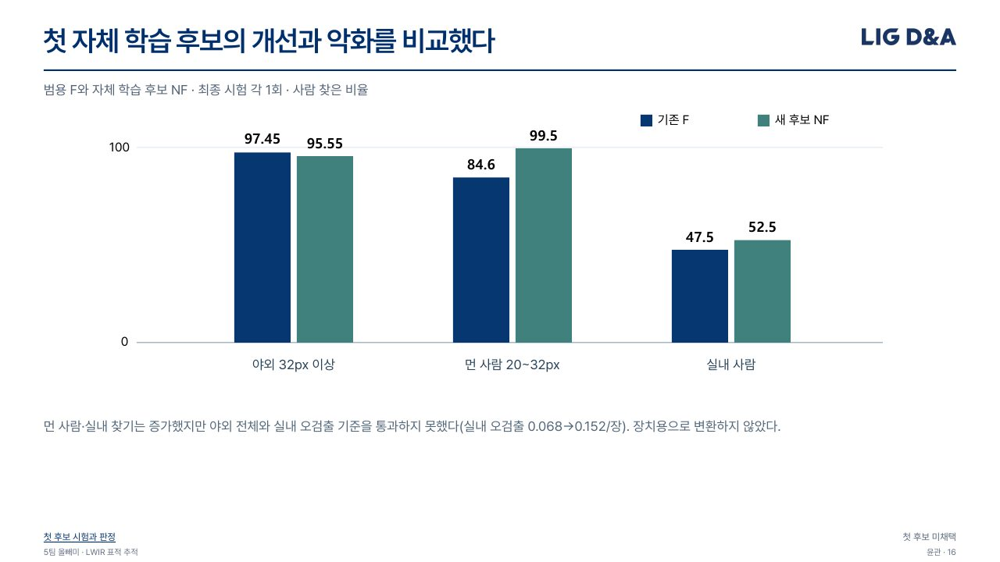
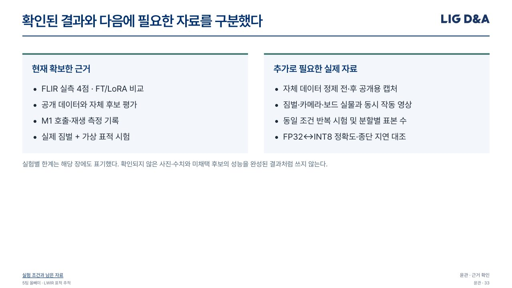

# 윤관 | 열화상 학습·추적과 짐벌 제어

제가 맡은 **열화상 모델 학습과 평가, 추적 모델 실험, 짐벌 제어**를 발표 순서대로 정리했습니다. 각 그림은 발표 PDF의 해당 페이지이며, 아래 설명을 따라 읽으면 전체 흐름을 볼 수 있습니다.

[발표 흐름 PDF · 33장](발표_전체흐름.pdf) · [전체 근거 PDF · 60장](발표_전체근거.pdf) · [발표 대본](notes.md) · [측정 조건과 출처](sources.md) · [HTML 발표자료](index.html)

> 수치는 기재된 데이터와 시험 조건에서의 결과입니다. 실측하지 않은 데이터 규모 중간점은 그래프에서 **보간 추정**으로 표시했습니다. 사진과 운영 화면은 실제 자료이며, 처리 과정과 모델 구조는 이해를 돕기 위해 그린 도식입니다.

## 담당 범위

### 01. 내가 맡은 일: 학습에서 짐벌 제어까지

저는 열화상 검출·자세 모델 학습과 평가, 그리고 짐벌 제어 시험을 맡았습니다. 각 결과는 측정 조건과 실패 사례까지 함께 설명하겠습니다.

## 1. 검출 모델 선택과 열화상 학습

### 02. YOLO26 계열을 고르고 m급을 학습했다

먼저 같은 FLIR 검증 조건에서 s급 모델 계열을 비교해 YOLO26s가 앞서는 것을 확인했습니다. 이후 YOLO26m을 기준으로 학습했지만 이 결과만으로 m급 전체의 우열을 입증한 것은 아닙니다.

### 03. M1에서 s와 m의 정확도·호출 시간을 비교했다

후속 M1 INT8 시험에서는 사람 AP가 s 42.32%, m 45.79%였고 호출 중앙값은 각각 19.02ms와 27.12ms였습니다. 한 번의 장치 시험이고 두 모델의 학습 이력도 달라 크기만의 효과로 해석할 수는 없습니다.

### 04. YOLO26m을 FLIR에 맞게 전체 파인튜닝했다

COCO 사전학습 가중치를 FLIR 열화상 자료에 전체 파인튜닝했습니다. 기본 실험은 640 입력, 배치 8, 최대 30에폭으로 AdamW와 워밍업, 코사인 일정을 사용했습니다.

### 05. 30에폭을 비교 예산으로 두고 후속 후보를 시험했다

30에폭은 조건을 맞추기 위한 최대 비교 예산이며 최적 종료점으로 입증된 값은 아닙니다. 이후 소형 객체 개선은 기본 모델에서 12에폭씩 여섯 후보를 별도로 비교했습니다.

### 06. 실제 에폭별 검증 곡선으로 학습 추이를 확인했다

이 그림은 실제 YOLO26s 에폭별 검증 곡선으로, FT와 LoRA의 학습 추이를 보여 줍니다. 한 시드의 s급 실험이므로 이 곡선으로 m급의 최적 에폭을 단정하지 않습니다.

### 07. 학습 데이터 규모에 따른 검증 정확도

데이터 규모 실험의 채운 점 네 개만 실제 측정이고 빈 점은 그 사이를 직선 보간한 값입니다. 이미지 수와 업데이트 수도 함께 늘어났기 때문에 데이터 수만의 인과효과나 보편적인 4천 장 최적점을 주장하지 않습니다.

### 08. 같은 업데이트에서 FT와 LoRA를 비교했다

10% 라벨에서 업데이트를 5,049회로 맞춘 별도 비교에서는 Full FT 29.89%, LoRA 33.96%였습니다. 같은 에폭 비교와는 학습 조건이 다르며 수치는 11월 12일 통합 기록에 근거해 원본 실행 파일 재대조가 필요합니다.

## 2. 자세 모델과 자체 데이터 학습

### 09. 자세 모델을 이어 학습하고 후보를 나눠 비교했다

자세 모델은 COCO 사전학습 뒤 OTP2 열화상, 흑백 COCO, MOT17을 순서대로 더해 E 계열을 만들었습니다. 그 계열에서 기존 자료를 쓰는 R0와 LLVIP를 추가한 R1을 비교했고 R1에서 가림 후보 O와 대조 C를 나눴습니다. C의 세 번째 에폭을 범용 F로 골랐고 자체 데이터 NF는 F에서 다시 학습했습니다.

### 10. 데이터를 추가한 순서와 이유

각 데이터의 역할은 다릅니다. OTP2는 열화상 자세, 흑백 COCO는 사람 형태, MOT17은 겹침, LLVIP-Pose는 중·원거리 열화상 장면을 보강하며, 기존 자료를 섞어 이어 학습했습니다.

### 11. 가림과 화면 밖 잘림을 학습에 반영했다

학습에서는 부분 확대와 물체 가림을 각각 확률 0.5로 사용하고, 크기·위치·회전을 바꿨습니다. 관절의 보임 표시가 잘못될 수 있어 모자이크는 끄되, 각 증강의 단독 효과는 아직 별도로 입증하지 못했습니다.

### 12. 자세 모델의 학습 설정을 정했다

자세 모델은 AdamW와 배치 16, 네 번의 기울기 누적으로 유효 배치 64를 사용했습니다. R0와 R1은 2e-4로 시작했고 후속 미세조정은 초기 성능 하락을 고려해 1e-4를 사용했습니다.

### 13. 우리 카메라 데이터의 정답을 다시 만들었다

자체 데이터는 야외 15편 8,929장과 실내 7편을 확보한 뒤 정답과 라벨을 정리했습니다. 이 숫자는 확보한 원본 범위로 실제 반복을 포함한 학습 예제 수와는 다릅니다.

### 14. 직접 촬영한 데이터의 정답을 정제했다

라벨이 없는 먼 배경 사람이 잘못된 배경으로 학습되는 문제를 줄이기 위해 자동 상자를 제외하고 학습 영상에서 빈 배경을 만들었습니다. 야외 관절 1,069명을 검수하고 불확실한 관절을 미상 처리했으며, 이 그림은 실제 원본 사진이 아닌 절차 도식입니다.

### 15. 자체 자료와 공개 자료를 섞어 이어 학습했다

범용 F를 시작점으로 자체 예제 1,960장과 공개 예제 1,954장을 섞어 8에폭 학습했습니다. 자체 실내 자료의 반복이 포함되어 있으며 배치 8과 누적 8회로 유효 배치 64를 맞췄습니다.

### 16. 첫 자체 학습 후보의 개선과 악화를 비교했다

첫 NF 후보는 먼 사람 검출이 올랐지만 야외 전체 검출률은 97.45%에서 95.55%로 내려갔고 실내 오검출은 장당 0.068에서 0.152로 늘었습니다. 후보별 한 번의 시험에서 미리 정한 기준을 통과하지 못해 장치용으로 채택하지 않았습니다.

### 17. 추적 점수는 올랐지만 모델은 바로 바꾸지 않았다

TMOT 검증의 HOTA와 IDF1은 개선됐지만 다른 필수 기준이 탈락해 추적 점수 하나만으로 모델을 교체하지 않았습니다. 실내 자료를 더한 두 번째 후보는 당시 진행 중이며 촬영 조건이 시험과 겹쳐 독립 실내 평가가 아닙니다.

### 18. 공개 데이터로 학습 결과를 검증했다

공개 OTP2와 TMOT에서도 근거리 E와 범용 F를 비교했습니다. 데이터셋과 지표가 서로 달라 막대는 같은 지표 안에서만 비교하며 TMOT은 후속 개발에도 사용되어 시스템 전체의 미사용 최종 시험은 아닙니다.

### 19. 작은 사람의 상자 크기 오류를 찾아냈다

F와 O는 작은 사람에서 전신 상자를 내고 큰 사람에서는 상체 상자를 내는 차이를 보였습니다. 데이터 전처리 코드는 수정했지만 기존 F와 O 가중치는 그대로이므로 새 후보와 분리해 평가해야 합니다.

## 3. 외형·위치 기억 모델

### 20. 사람을 다시 구분할 외형 모델도 적응시켰다

추적할 사람의 외형을 구분하기 위해 RepVGG도 OTP2 실내 사람 자료로 추가 학습했습니다. PC float 시험 60개 신원에서 몸 상자 Top-1은 72%에서 89%로 올랐지만, M1 INT8 정확도 결과는 별도 확인이 필요합니다.

### 21. 가려진 동안 위치를 기억하는 모델을 다시 학습했다

위치 기억 GRU는 우리 검출기의 TMOT·DanceTrack 출력으로 다시 학습했습니다. 기존 모델이 화면 가장자리 정보를 잘못 이용하는 문제를 찾아 입력과 라벨 처리를 고쳤으며 분석에 본 시험 영상도 사용했습니다.

### 22. 장치 녹화에서 위치 기억의 추적 결과를 비교했다

장치에서 같은 녹화 한 편을 재생했을 때 새 GRU의 IDF1은 75.36, Kalman은 71.81이었습니다. 한 영상의 결과이고 자체 영상 전체의 위치 오차에서는 Kalman이 더 낮은 조건도 있어 일반적인 우위로 단정하지 않습니다.

### 23. Mamba 위치 기억도 다시 학습해 비교했다

Mamba 위치 기억도 재학습해 놓친 위치 오차가 0.361에서 0.127로 낮아졌습니다. 다만 같은 자료의 Kalman 0.110보다 높았고 원인 분석에 시험 영상을 사용했으므로 독립 최종 성능은 아닙니다.

## 4. End-to-End FastTrackTr

### 24. FastTrackTr 논문 원형과 M1 구현을 구분했다

왼쪽은 FastTrackTr 논문 원형의 과거 특징 인코더·디코더와 연결 개념입니다. 오른쪽은 M1 연산 제약을 고려한 프로젝트 구현으로 300개 질의와 두 디코더 조각을 쓰고 직전 디코더 출력을 다음 프레임에 전달합니다.

### 25. FastTrackTr 학습 조건을 설정했다

FastTrackTr은 DanceTrack 흑백으로 6에폭 학습한 뒤 TMOT 열화상 24편과 DanceTrack 일부를 섞어 3에폭 추가 학습했습니다. 학습률은 5e-5, 배치는 4이며 백본에는 0.1배의 학습률을 적용했습니다.

### 26. FastTrackTr을 열화상으로 추가 학습했다

TMOT 검증 여섯 편의 평균 IDF1은 15.3에서 27.1로 올랐지만 실내 두 녹화는 악화됐고 기존 검출·추적 기준보다 낮아 시험용으로 유지했습니다. 28ms는 프레임을 겹쳐 처리한 장치 단계 시간이지 카메라부터 화면까지의 지연이 아닙니다.

## 5. M1 배포와 실제 운영 화면

### 27. 학습한 검출기를 INT8으로 변환해 M1에서 실행했다

학습한 검출기를 640×480 INT8 DXNN으로 변환하고 보정 자료 8장을 사용했습니다. 300회 임의 입력의 NPU 호출 시간과 약 20초 실카메라 처리량은 서로 다른 시험이므로 같은 종단 지연으로 합치지 않습니다.

### 28. 실제 운영 화면에서 검출과 ID를 확인했다

왼쪽은 실제 8090 화면에서 TMOT 녹화를 재생한 화면이고 오른쪽은 별도 녹화와 M1 출력입니다. 검출 박스와 ID를 확인할 수 있지만 실시간 짐벌 동시 추종을 증명하는 장면은 아닙니다.

## 6. 짐벌 제어와 가림 전후 비교

### 29. 화면 오차를 짐벌 명령으로 연결하고 설정을 조정했다

선택된 사람 위치와 화면 중심의 차이를 불감대와 제어기를 거쳐 팬·틸트 명령으로 연결했습니다. 시험에서는 불감대를 0.04에서 0.06으로, 제어기를 PID에서 PD 설정으로 조정했습니다.

### 30. 가림으로 사람을 놓쳤을 때 대응 기능을 추가했다

추적 대상을 잠시 놓쳤을 때 최대 800ms 예측 위치를 유지하고 다른 사람으로 잘못 넘어가는 것을 막는 설정을 장치에 적용했습니다. 실카메라 비교는 짧아 재포착 성능 개선을 결론내릴 수 없습니다.

### 31. 불감대를 바꾸고 짐벌 응답을 측정했다

실제 짐벌과 카메라에 가상 표적을 주고 등속 응답을 비교했습니다. 정지 후 상하 방향 반전은 4회에서 1회로 줄었지만 조건별 각 1회이고 별도 가로 뒤처짐은 14.3에서 18.6px로 악화됐습니다.

### 32. 같은 FLIR 영상에서 가림 전과 재등장 뒤를 비교했다

같은 FLIR 개발 영상의 가림 전과 재등장 뒤를 나란히 보여 줍니다. 동일 검출 결과를 쓰는 한 사례에서 기준은 ID가 바뀌고 후보는 유지했지만, 구성 선택에 쓴 자료라 전체 가림 상황의 보장은 아닙니다.

## 7. 남은 검증과 필요한 자료

### 33. 확인된 결과와 다음에 필요한 자료를 구분했다

남은 과제는 실제 자체 데이터 정제 전후 공개 가능한 캡처, 짐벌 본체와 동시 작동 영상, 반복 실험, FP32와 INT8 정확도의 동일 조건 비교입니다. 확보되지 않은 결과는 성과로 바꾸어 말하지 않겠습니다.

---

### 아직 필요한 자료와 확인할 점

- **짐벌 실물 사진과 동시 추종 영상:** 본체 사진, 실제 사람을 추종하면서 짐벌이 움직이는 장면은 아직 확보하지 못했습니다. 짐벌 응답 시험은 실제 장치에 가상 표적을 사용한 조건입니다.
- **자체 카메라 원본:** 정제 전후를 보여 주는 공개 가능한 실제 사진이 아직 없습니다. 본문에서는 절차를 도식으로 표시했습니다.
- **추가 검증:** 짐벌 반복 시험, 독립된 자체 카메라 평가, 같은 조건의 FP32·INT8 정확도 비교가 필요합니다.
- **팀 발표 분량:** 위 33장은 상세 흐름입니다. 최종 발표 시간과 팀 내 담당 범위에 맞춰 장수를 조정합니다.

학습·시험 수치는 2026-11-16 확인한 model-bank 기록을 기준으로 했습니다. 상세 조건과 원문 링크는 [출처 정리](sources.md)를 참조하세요. 폰트와 로고는 팀 초안의 에셋을 사용했으며, 폰트 라이선스는 [FONT-LICENSE](assets/FONT-LICENSE.txt)에 있습니다.
