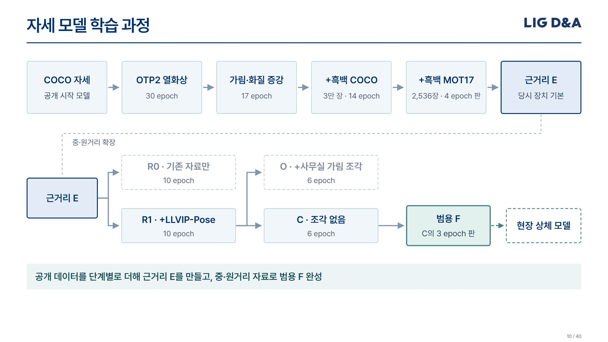
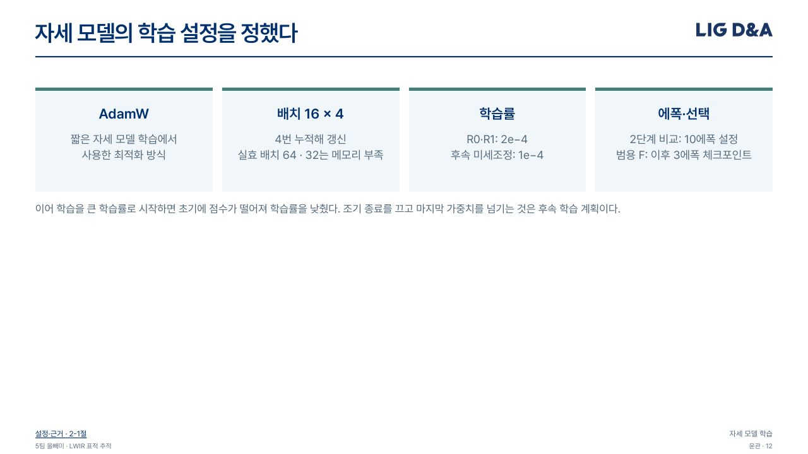
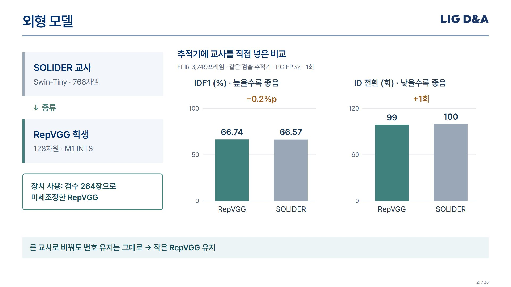
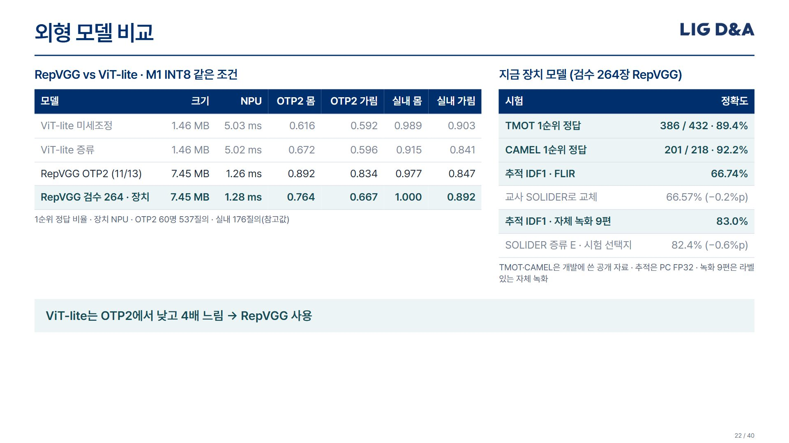
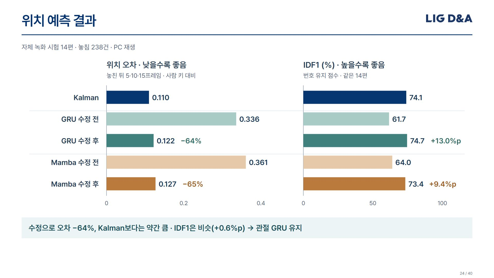
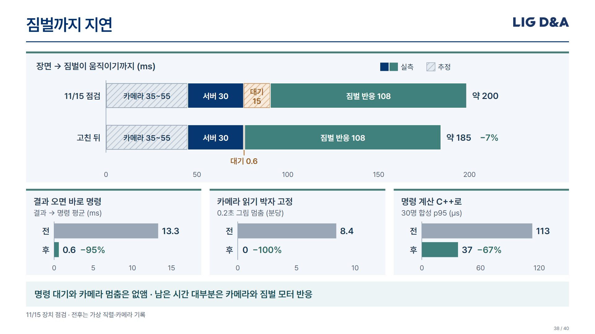

# 윤관 | 열화상 모델 학습 · 경량화 · 짐벌 추종

열화상 사람 검출·자세 모델 학습, 추적을 돕는 최신 모델 조사, M1에서 제때 돌리기 위한 경량화, 짐벌이 사람을 놓치지 않게 하는 튜닝과 실측을 정리했습니다.

**자료:** [발표 흐름 PDF](발표_전체흐름.pdf) · [근거 자료까지 PDF](발표_전체근거.pdf) · [발표 대본](notes.md) · [슬라이드별 근거](근거_슬라이드별.md) · [실험·논문 출처](sources.md) · [11월 20일 추가 근거](근거_최신_20261120.md) · [11월 19일 근거](근거_최신_20261119.md) · [평가자 검토](평가자_검토.md) · [모델별 입출력·로그](학습_입출력_로그.md) · [학습 설정·데이터 근거](학습_설정_데이터_근거.md) · [HTML로 보기](index.html)

**흐름:** 해결할 문제 → 열화상 검출기 학습 → 자세·상체 모델과 자체 데이터 → 추적 보완 모델(외형·위치 예측·FastTrackTr) → 경량화와 M1 실행 → 짐벌 추종 → 정리. 실험마다 조건이 다르며, 한 모델을 모든 단계로 이어서 학습한 이력은 아닙니다.

**고치는 법:** 장마다 `src/slides/`(화면), `src/notes/`(대본), `src/sources/`(근거) 파일이 있고 순서는 `src/deck.txt`입니다. `python src/build.py`로 HTML·대본·README를 만들고, `python src/render.py`로 PDF와 아래 그림을 만듭니다(Playwright 필요). 11월 19일 판은 git 기록(커밋 9819922)에 있습니다.

## 소개

### 01. 담당 범위

제가 맡은 일은 크게 네 가지입니다.

### 02. 해결할 문제

풀어야 할 문제는 네 가지였습니다.

## 열화상 검출기 학습

### 03. 검출 모델 비교

먼저 어떤 계열을 쓸지 정해야 했습니다.

### 04. 열화상 전이학습

이 모델은 COCO로 사전학습된 YOLO26m에서 시작했고, FLIR 열화상 10,491장으로 전체 가중치를 다 학습했습니다.

### 05. 학습 곡선

학습 곡선을 보면, YOLO26m은 27 epoch에서 사람 AP 50.75%로 가장 높았습니다.

### 06. Full FT와 LoRA

Full FT는 모든 가중치를 학습하고, LoRA는 원래 가중치는 고정한 채 작은 보정 행렬과 검출 머리만 학습합니다.

### 07. 데이터 규모

데이터를 얼마나 모아야 하는지도 궁금했습니다.

### 08. 검출기 증류

검출기 증류는 큰 YOLO26m의 특징을 작은 YOLO26s가 따라 하도록 학습하는 방법입니다.

## 자세·상체 모델

### 09. 학습 데이터

자세·상체 모델에 쓴 데이터입니다.

### 10. 자세 모델 학습 과정

자세 모델은 한 번에 만든 게 아니라, 공개 데이터를 한 단계씩 더해 가면서 키웠습니다.

### 11. 가림 증강

가림 증강은 몸이 가려지거나 화면 밖으로 잘려도, 머리부터 골반까지의 박스와 관절 위치를 정답으로 그대로 남겨 두고 학습하는 방법입니다.

### 12. 공개 데이터 평가

범용 F를 공개 시험 세 가지로 근거리 E와 비교했습니다.

### 13. 자체 영상 라벨링

저희 영상은 라벨 편집기로 직접 검수했습니다.

### 14. 사람 박스 정의

사람 박스를 어디까지로 잡을지도 정해야 했습니다.

### 15. 원거리 배경 정리

야외 녹화를 보면 먼 줄에 정답이 없는 사람이 많습니다.

### 16. 자체·공개 혼합 학습

NF는 자체 자료와 공개 자료를 같은 양으로 섞어서 학습한 모델입니다.

### 17. 검수 264장 학습

다음은 저희가 검수한 영상 264장으로 학습한 V7과 V8입니다.

### 18. 현장 650장 상체 모델

지금 장치의 기본 검출기가 이 상체 E10입니다.

### 19. 교체 후보 재학습

E10을 더 좋은 모델로 바꿀 수 있을지 여러 방식으로 다시 학습해 봤습니다.

## 추적 보완 모델

### 20. 추적 보완 세 갈래

추적을 보완하려고 세 갈래를 시험했습니다.

### 21. 외형 모델

외형 모델은 큰 교사 SOLIDER에서 작은 RepVGG 학생으로 증류했습니다.

### 22. 외형 모델 비교

ViT-lite와 RepVGG를 같은 조건으로 비교한 표입니다.

### 23. 가림 위치 예측

가려져서 검출이 끊기면, 그동안 위치를 이어 주는 모델입니다.

### 24. 위치 예측 결과

처음에 GRU 학습 입력에 문제가 있어서 그걸 먼저 고쳤습니다.

### 25. 박스 크기 안정화

화면 박스가 덜 흔들리게 하는 박스 보정입니다.

### 26. 상체 박스와 전신 표시

추적과 짐벌 조준은 상체 박스를 그대로 씁니다.

### 27. FastTrackTr

FastTrackTr은 검출과 번호 붙이기를 한 모델로 하는 종단간 방식입니다.

## 경량화·M1 실행

### 28. INT8 변환

DX-COM 컴파일 옵션 하나로 M1 처리 시간을 25% 줄인 이야기입니다.

### 29. M1 모델 속도

YOLO26m은 s보다 사람 AP가 3.47%p 높지만, M1에서 한 번 호출하는 데 43% 더 걸립니다.

### 30. 두 NPU 한 장 분할

한 장을 둘로 나눠서 NPU 0과 1에서 동시에 검출하는 방식입니다.

### 31. 분할 모델 만들기

분할 모델은 새로 학습한 게 아닙니다.

### 32. 33 ms 꼬리 줄이기

분할 뒤에도 가끔 느린 장이 나와서, 그 원인을 하나씩 찾아 고쳤습니다.

## 짐벌 추종

### 33. 짐벌 추종 구조

짐벌 추종 구조입니다.

### 34. PD 제어와 불감대

11월 10일에 실제 짐벌에 가상 표적을 넣고 후보 값을 직접 비교했습니다.

### 35. 짐벌 실측 응답

실제 짐벌이 명령에 어떻게 반응하는지 직접 재 봤습니다.

### 36. 가상 카메라 시험

가상 카메라 시험은 실제 짐벌을 안 돌리고도 장치 전체를 같은 장면으로 반복해서 비교하고, 정답으로 채점하는 방법입니다.

### 37. 원거리 가속

실측한 짐벌 속도로 모의 시험을 다시 돌려서, 빠른 사람을 화면에 더 오래 두도록 속도 설정 두 가지를 바꿨습니다.

### 38. 짐벌까지 지연

장면이 바뀌고 짐벌이 움직이기까지 약 0.2초가 걸립니다.

### 39. 놓쳤을 때 대응

사람을 놓쳤을 때 쓰는 기능들입니다.

## 정리

### 40. 정리

정리하겠습니다.
